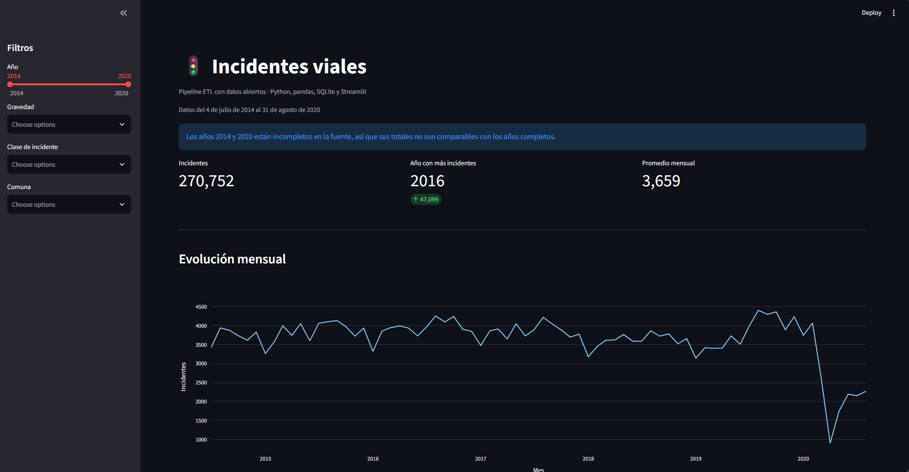

# Pipeline ETL + Dashboard: incidentes viales de Medellín



Pipeline de ingeniería de datos que descarga datos abiertos de incidentes viales
(Secretaría de Movilidad de Medellín, MEData), los limpia, los carga en SQLite y
los muestra en un dashboard interactivo.

## Arquitectura

```
CSV (MEData) -> extract.py -> transform.py -> load.py -> SQLite -> Streamlit
```

## Uso

```bash
python -m venv venv
venv\Scripts\activate          # Windows
pip install -r requirements.txt

# 1. Pega el enlace del CSV en src/config.py (variable URL)
# 2. Corre el pipeline
python src/run_pipeline.py

# 3. Abre el dashboard
python -m streamlit run dashboard/app.py
```

Si ya tienes el CSV en `data/raw/incidentes_viales.csv`:
`python src/run_pipeline.py --skip-extract`

## Estructura

- `src/extract.py`: descarga el CSV crudo
- `src/transform.py`: normaliza columnas, limpia texto, parsea fechas, valida coordenadas
- `src/load.py`: carga a SQLite
- `src/run_pipeline.py`: orquesta todo
- `dashboard/app.py`: dashboard con filtros, KPIs y gráficos

## Fuente de datos

Incidentes viales, Secretaría de Movilidad de Medellín (MEData).
Licencia: CC BY-SA 4.0.

- Cobertura real del archivo: **4 de julio de 2014 al 31 de agosto de 2020** (~270,000 incidentes).
- 2014 y 2020 son años incompletos; el dashboard lo avisa y los excluye del KPI de "año con más incidentes".
- 2020 incluye el periodo de cuarentena por COVID-19, por lo que no es comparable con años anteriores.

## Qué hace el pipeline

- Normaliza nombres de columnas (sin tildes ni espacios) y limpia el texto.
- Elimina duplicados y registros sin fecha válida.
- Usa la fecha en hora local y descarta la columna UTC (5 horas adelantada).
- Extrae latitud y longitud de la columna `location` y descarta coordenadas fuera de Medellín.
- Crea columnas derivadas: año, mes, día de la semana y hora.


